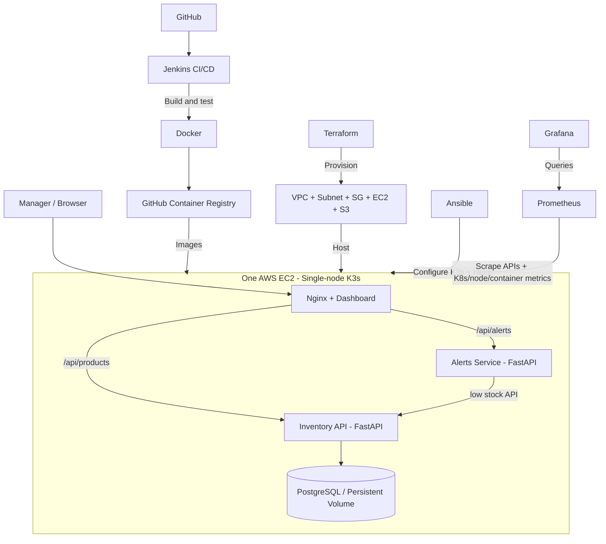

# Architecture

## Request flow
1. Browser opens dashboard (local port 8080, AWS node port 30080).
2. Nginx serves static HTML and forwards `/api/products` to Backend, `/api/alerts` to Alerts.
3. Backend stores products in PostgreSQL. Alerts calls Backend's `/products/low-stock`.
4. Prometheus/Grafana monitor infrastructure and application. The lightweight alert service exposes *in-app warnings via periodic dashboard polling*, not email or push notifications.

## Delivery flow
`git push` -> Jenkins checkout/test/build/push -> GHCR images -> Jenkins SSH rollout restart on the EC2 K3s host.

## Notes
- This is a low-cost-in-complexity **demo** architecture, not a production HA design.
- Single EC2 is a single point of failure; one PostgreSQL PVC, no automated backups/HA.
- All team edits go through feature branches and pull requests before merge into `main`.
- S3 is provisioned for future report/backup storage; this starter does **not** upload files into it.
- Do not expose Jenkins, PostgreSQL or Kubernetes API publicly. Restrict SSH/Grafana to the team IP.
